# 🎬 REELSPOT

**REELSPOT** is a responsive movie-streaming website built with HTML, Tailwind CSS and vanilla JavaScript. It opens on a full-screen featured film. Click any poster in the **Recently Added** or **Top Rated** grids to see that movie's details: genre, year, runtime, synopsis, director and cast. You can search the catalog, save favorites, set a profile name and sign up for the newsletter. It works on phones, tablets and desktops.

🔗 **Live demo:** https://laurence421.github.io/ReelSpot-project/

## 📸 Screenshots

### Featured film
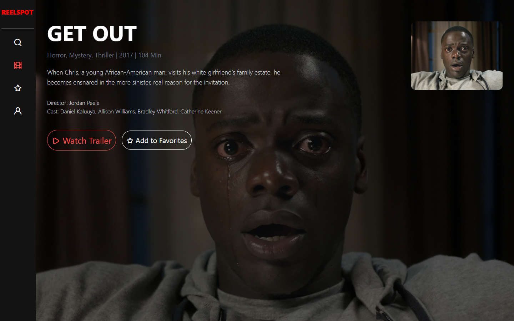

### Movie details
Click any poster to show its details at the top of the page, with a trailer link and a favorites button.

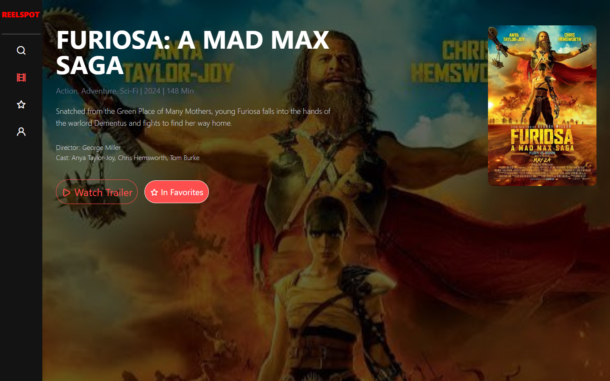

### Movie grids
Each poster has a ⭐ button to add it to your favorites. The movie being shown is outlined in red.

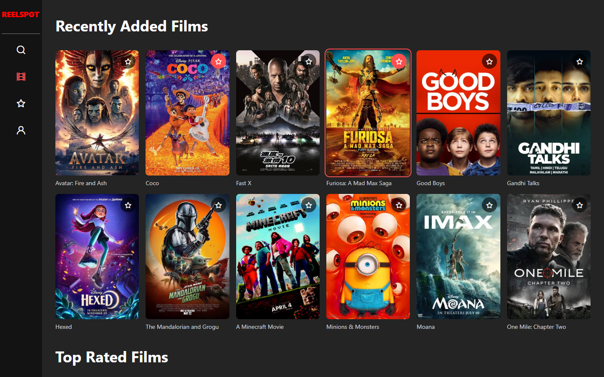

### Search
Search by title, genre, director or cast. The results update as you type.

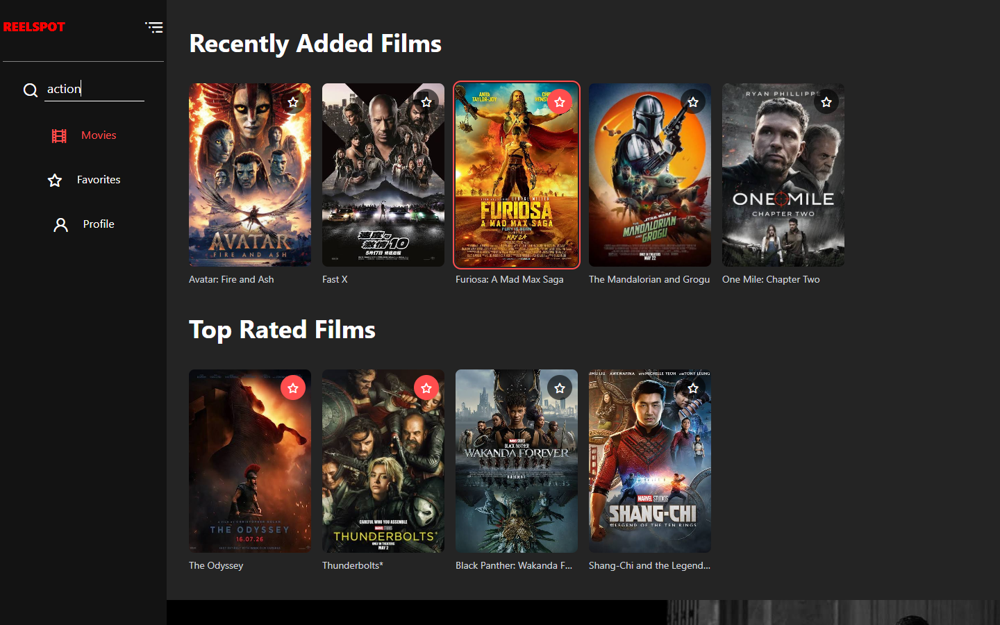

### Favorites
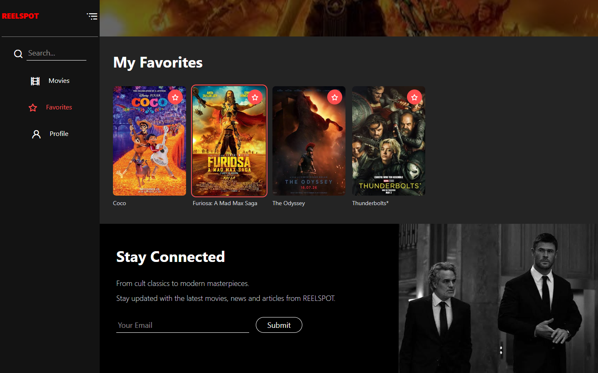

### Profile
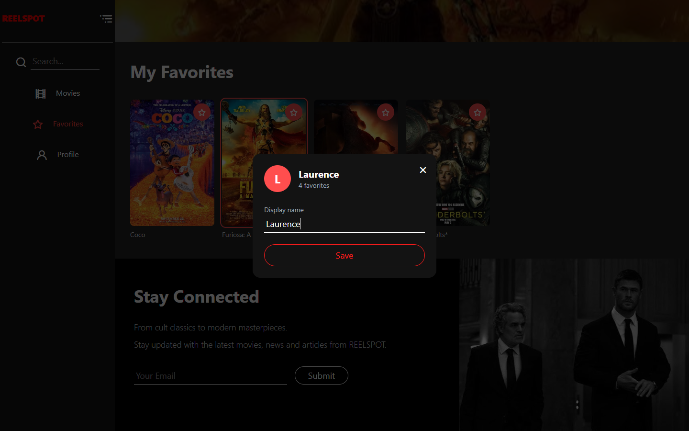

### Stay Connected footer
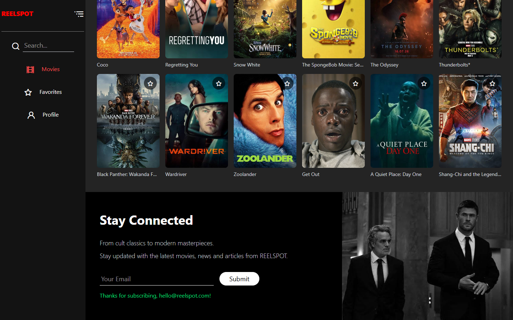

### Mobile
<p>
  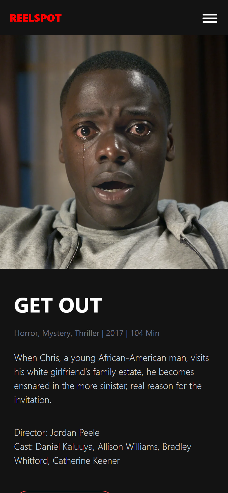
  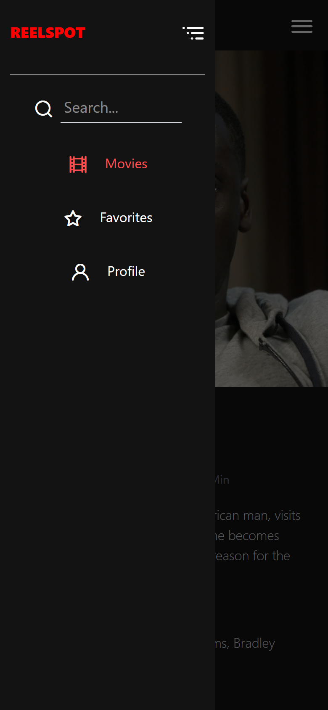
  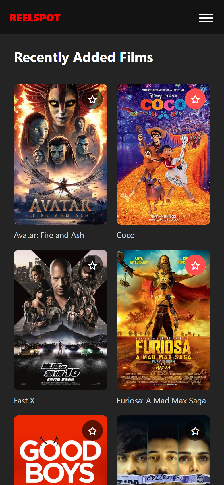
</p>

<details>
<summary>Full page (desktop)</summary>

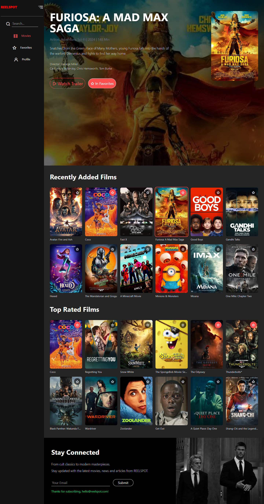

</details>

## ✨ Features

- **Movie details:** click any poster to show its genre, year, runtime, synopsis, director and cast in the featured section at the top.
- **Watch Trailer:** opens a YouTube search for the selected movie's official trailer in a new tab.
- **Categorized browsing:** movies are grouped into "Recently Added" and "Top Rated."
- **Live search:** filter movies by title, genre, director or cast as you type, with a "no results" message when nothing matches.
- **Favorites:** add or remove a movie with the ⭐ on its poster or the button in the featured section. Favorites have their own view and are saved in your browser (`localStorage`), so they're still there after a reload.
- **Profile:** set a display name, see your favorites count and get an avatar with your initial. This is also saved in your browser.
- **Newsletter sign-up:** checks the email address and shows a success or error message. This is front-end only; no email is sent or stored.
- **Sidebar navigation:** on desktop, the sidebar expands to show search and labels. On mobile, it becomes a slide-in menu opened from the top bar. You can close it with the menu icon, by tapping outside it, or with `Esc`.
- **Responsive design:** the poster grids go from 2 to 6 columns depending on screen width. The layout fits phones (from 360px wide), tablets and desktops with no sideways scrolling.

## 🛠️ Tech Stack

- **HTML5:** semantic markup structure of the web pages.
- **Tailwind CSS (v4 browser build):** utility-first CSS framework used for responsive layouts and styling.
- **JavaScript (ES6+):** movie data, rendering the poster grids, search, favorites, profile and sidebar logic.
- **localStorage:** saves favorites and the profile name in the browser.
- **Unicons:** icon set.
- **GitHub Pages:** used for hosting and deployment.

## 🚀 Run Locally

No build step is needed. Clone the repo and open `index.html` in your browser:

```bash
git clone https://github.com/Laurence421/ReelSpot-project.git
cd ReelSpot-project
start index.html   # Windows (use `open` on macOS, `xdg-open` on Linux)
```

## ➕ Adding a Movie

Movies are listed in the `movies` array at the top of `reelspot.js`. Put the poster in `img/` and add an entry:

```js
{ id: 'dune2', title: 'Dune: Part Two', poster: './img/dune2.jpg', genre: 'Sci-Fi, Adventure', year: 2024, runtime: 166,
  synopsis: 'Paul Atreides unites with the Fremen...', director: 'Denis Villeneuve', cast: 'Timothée Chalamet, Zendaya',
  lists: ['recent'] }   // 'recent', 'top', or both
```

`year`, `runtime`, `director` and `cast` are optional. If you leave one out, it's hidden on the page.

## 📁 Project Structure

```
├── index.html      # Page markup (sidebar, featured film, grids, footer, profile window)
├── reelspot.css    # Sidebar open/close states, mobile menu, favorite and selected styles
├── reelspot.js     # Movie data and all interactive features
├── img/            # Movie posters and images
└── screenshots/    # README screenshots
```

## 🎯 Credits & Inspiration

- Layout design credit: [Video Streaming Website – Responsive web app prototype (Figma Community)](https://www.figma.com/design/XVKhl4yI1Y3ye7eVxIZeKE/Video-Streaming-Website---Responsive-web-app-prototype--Community-?node-id=602-227&t=WJ8jTuigDouvsoyP-0)
- Movie posters and images belong to their respective owners and are used for non-commercial learning purposes only.

> **Note:** This project is a front-end practice and portfolio piece to improve my HTML, Tailwind CSS and JavaScript skills.
