# 🎬 REELSPOT

**REELSPOT** is a free movie website built with HTML, Tailwind CSS and vanilla JavaScript. You can browse a catalog of films, watch trailers right on the site, open a page for each movie with a link you can share, filter by genre, search, and save favorites. It needs no accounts, no server and no paid services. It runs entirely in the browser and is hosted for free on GitHub Pages.

🔗 **Live site:** https://laurence421.github.io/ReelSpot-project/

## 📸 Screenshots

### Home: rotating featured movie
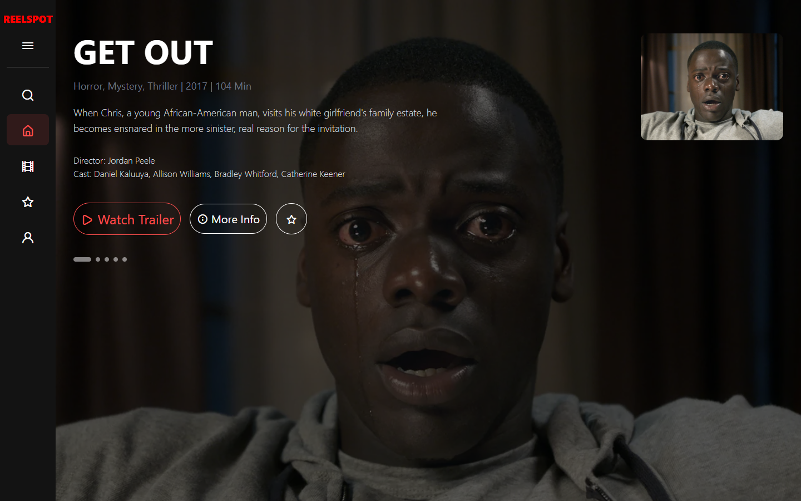

### Trailers play on the site
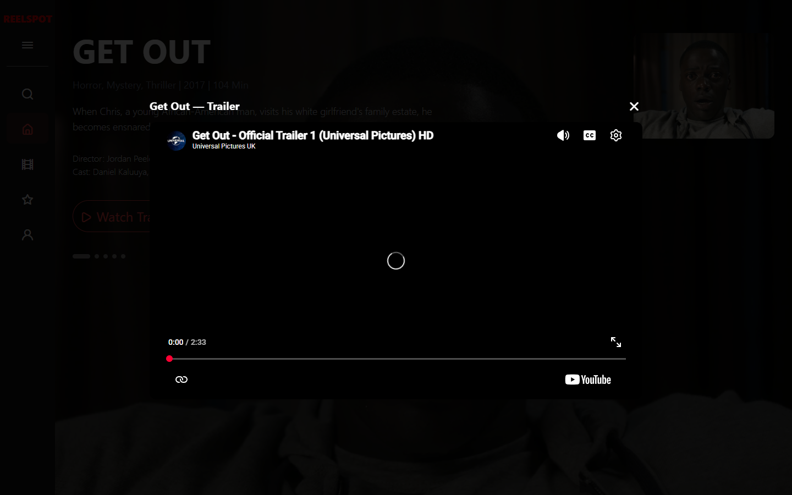

### Movie page
Every movie has its own page with a link you can share, like `movie.html?id=furiosa`.

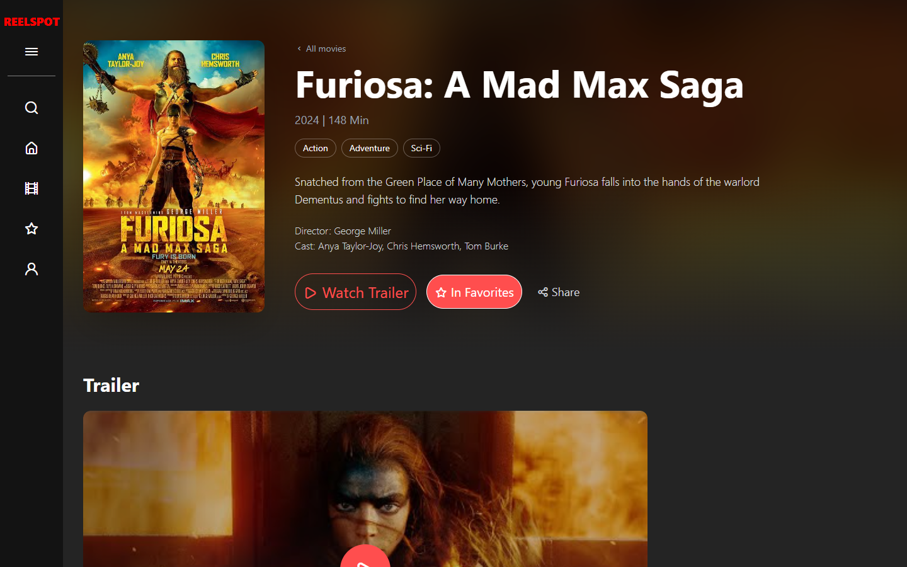
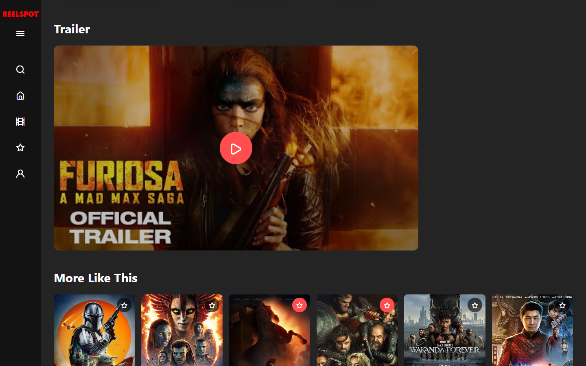

### Browse: lists, genres, sorting and search
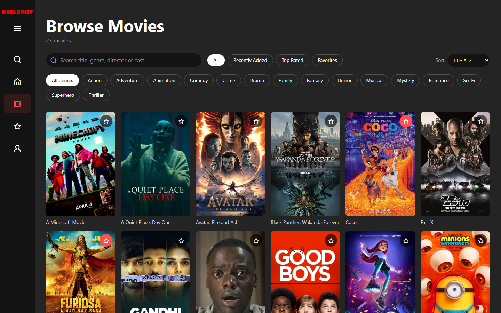
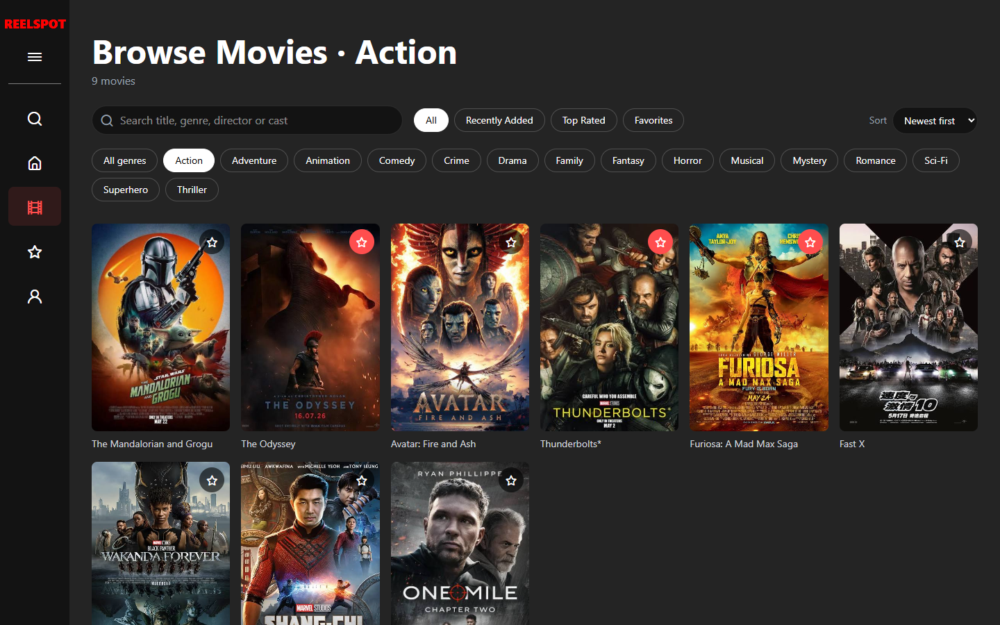

### Favorites and profile
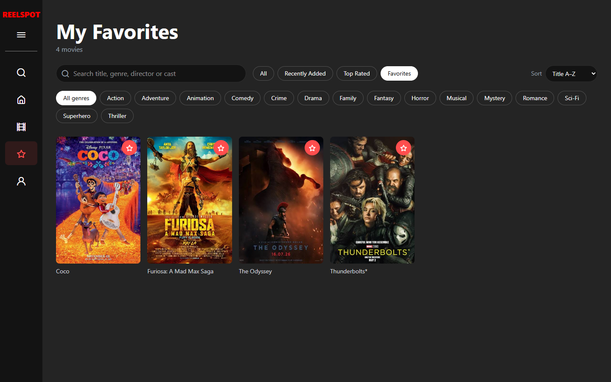
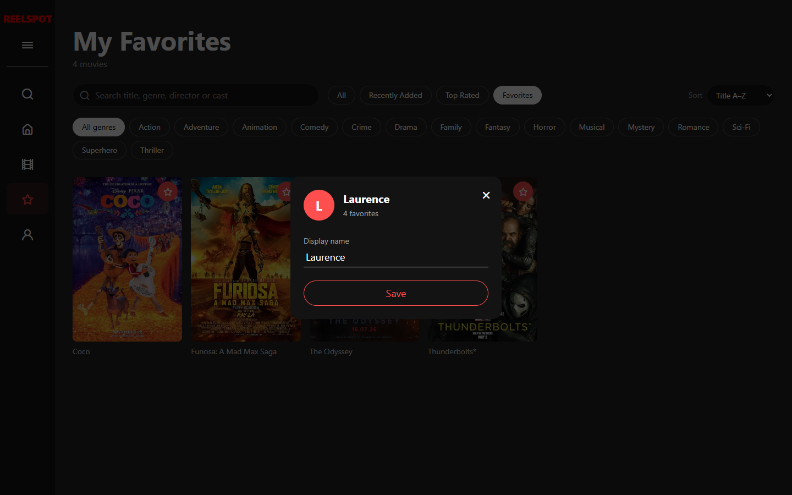

### Home rows and sidebar
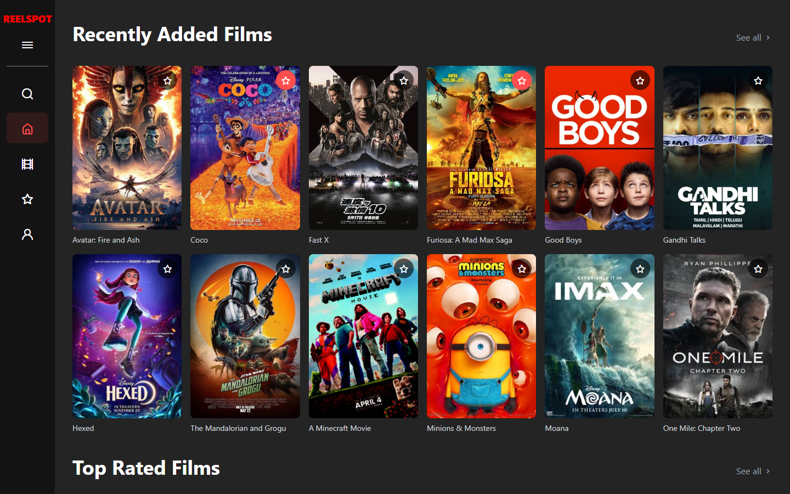
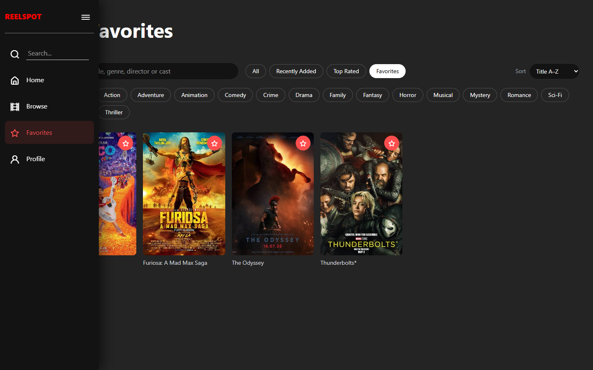

### Mobile
<p>
  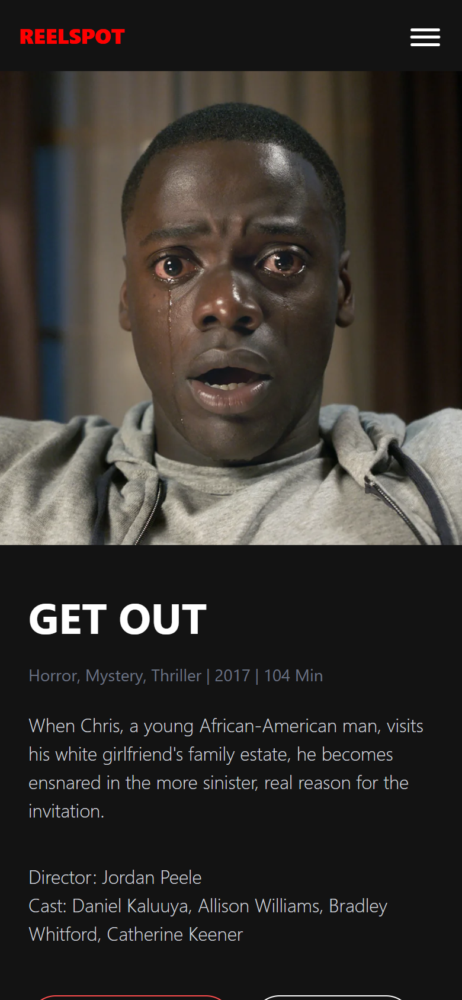
  
  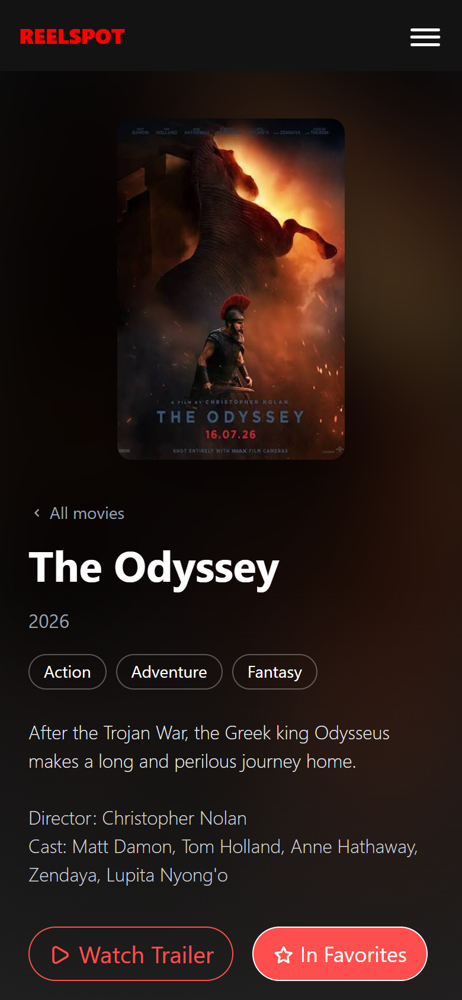
  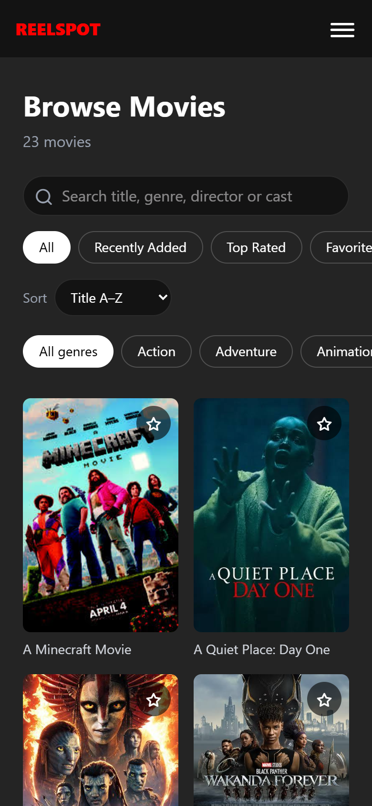
</p>

## ✨ Features

**Home page**
- **Featured movies:** the top section rotates through 5 featured movies every 8 seconds. Use the dots to jump between them; rotation pauses while your mouse is over it.
- **Rows:** "Recently Added" and "Top Rated" rows, each with a "See all" link.

**Trailers**
- **On-site player:** Watch Trailer opens a pop-up player. It uses YouTube's privacy-enhanced (`youtube-nocookie`) embed. Close it with ✕, Esc or a click outside, and the video stops.
- **On movie pages:** the trailer shows as a thumbnail that loads the player only when you click it.

**Movie pages (`movie.html?id=…`)**
- **Details:** poster, year, runtime, synopsis, director and cast. Genre tags link to the Browse page filtered by that genre.
- **Buttons:** Watch Trailer, Add to Favorites, and Share (copies the link, or opens the share menu on phones).
- **More Like This:** up to 6 movies with the most genres in common.
- **Missing movies:** a link to a movie that doesn't exist shows a friendly "Movie not found" page.

**Browse page (`browse.html`)**
- **Lists:** All, Recently Added, Top Rated or Favorites.
- **Genres:** filter by any genre found in the catalog.
- **Sorting:** title A–Z, newest, oldest or longest.
- **Search:** by title, genre, director or cast, with a "Clear filters" button when nothing matches.
- **Shareable views:** filters are saved in the URL, so a view like `browse.html?genre=Comedy&sort=newest` can be shared.

**Everywhere**
- **Favorites:** tap ⭐ on any poster. Favorites are saved in your browser (`localStorage`) and appear on every page.
- **Profile:** set a display name and see your favorites count. Also saved in your browser.
- **Sidebar:** on desktop, a collapsed icon bar; the ☰ button expands it over the page. On phones, a slide-in menu.
- **Search box:** the sidebar search filters the page you're on. On a movie page, pressing Enter takes you to Browse with your search.
- **Newsletter form:** checks the email address and shows a message. This is front-end only; no email is sent or stored.
- **Responsive design:** works on phones (from 360px wide), tablets and desktops.

> **Note:** favorites and profile are saved per browser. They don't sync between devices, because there are no accounts.

## 🛠️ Tech Stack (all free)

- **HTML5**
- **Tailwind CSS (v4 browser build):** utility-first styling and responsive layouts.
- **JavaScript (ES6+):** no frameworks and no build step.
- **localStorage:** saves favorites and the profile name.
- **YouTube embeds:** free trailer playback.
- **Unicons:** free icon set.
- **GitHub Pages:** free hosting.

## 🚀 Run Locally

Clone the repo and open `index.html` in your browser:

```bash
git clone https://github.com/Laurence421/ReelSpot-project.git
cd ReelSpot-project
start index.html   # Windows (use `open` on macOS, `xdg-open` on Linux)
```

Trailers play best from a local web server, because some browsers block YouTube embeds on `file://` pages. For example:

```bash
npx serve .        # then open the address it prints
```

## ➕ Adding a Movie

All movies live in `movies-data.js`. Put the poster in `img/` and add an entry:

```js
{ id: 'dune2', title: 'Dune: Part Two', poster: './img/dune2.jpg', genre: 'Sci-Fi, Adventure', year: 2024, runtime: 166,
  trailer: 'VIDEO_ID',      // the part after "watch?v=" in the YouTube link
  synopsis: 'Paul Atreides unites with the Fremen...', director: 'Denis Villeneuve', cast: 'Timothée Chalamet, Zendaya',
  lists: ['recent'] }       // 'recent', 'top', both, or [] for Browse only
```

`year`, `runtime`, `director`, `cast` and `trailer` are optional. If you leave out `trailer`, Watch Trailer opens a YouTube search instead. To feature a movie on the home page, add its `id` to `featuredIds` at the bottom of the file.

After changing a `.js` or `.css` file, raise the `?v=` number in the HTML files (e.g. `?v=4` → `?v=5`) so visitors get the new version right away.

## 📁 Project Structure

```
├── index.html       # Home page
├── browse.html      # Browse / Favorites page
├── movie.html       # Movie page (movie.html?id=...)
├── movies-data.js   # The movie catalog and featured list
├── reelspot.js      # Shared code: sidebar, footer, favorites, profile, trailer player
├── home.js          # Home page: featured rotation and rows
├── browse.js        # Browse page: lists, genres, sorting, search
├── movie.js         # Movie page: details, inline trailer, More Like This, share
├── reelspot.css     # Sidebar, favorite and chip styles
├── img/             # Movie posters and images
└── screenshots/     # README screenshots
```

## 🎯 Credits & Inspiration

- Layout design credit: [Video Streaming Website – Responsive web app prototype (Figma Community)](https://www.figma.com/design/XVKhl4yI1Y3ye7eVxIZeKE/Video-Streaming-Website---Responsive-web-app-prototype--Community-?node-id=602-227&t=WJ8jTuigDouvsoyP-0)
- Trailers are embedded from YouTube, mostly from the studios' official channels.
- Movie posters and images belong to their respective owners and are used for non-commercial learning purposes only.

> **Note:** This project is a front-end practice and portfolio piece to improve my HTML, Tailwind CSS and JavaScript skills.
