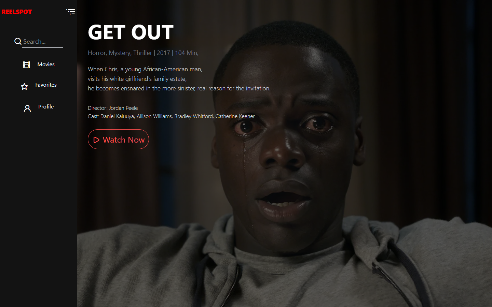

# 🎬 REELSPOT

**REELSPOT** is a responsive movie-streaming landing page built with HTML, Tailwind CSS and vanilla JavaScript. It opens on a full-screen featured film (title, genre, year, runtime, synopsis, director and cast) with a "Watch Now" call to action, followed by poster grids of **Recently Added** and **Top Rated** films, and ends with a "Stay Connected" newsletter footer. A collapsible sidebar gives quick access to Search, Movies, Favorites and Profile.

🔗 **Live demo:** https://laurence421.github.io/ReelSpot-project/

## 📸 Screenshots

### Featured film


### Expanded sidebar
Click the sidebar to open it with search and labels; click the menu icon to collapse it.



### Movie grids


### Stay Connected footer


### Mobile


<details>
<summary>Full page (desktop)</summary>


</details>

## ✨ Features

- **Featured movie hero:** essential movie info, including genre, year, runtime, director, cast and a brief synopsis.
- **Categorized browsing:** easily find content under sections like "Recently Added" and "Top Rated."
- **Sidebar navigation:** a collapsible sidebar with search and links to Movies, Favorites and Profile.
- **Dynamic interactions:** JavaScript opens and closes the sidebar for a smooth experience.
- **Modern UI:** a sleek, responsive design using Tailwind CSS that looks great on both mobile and desktop screens.

## 🛠️ Tech Stack

- **HTML5:** semantic markup structure of the web pages.
- **Tailwind CSS:** utility-first CSS framework used for rapid UI development, responsive layouts and modern styling.
- **JavaScript (ES6+):** powers the dynamic behaviors, DOM manipulation and interactive elements.
- **GitHub Pages:** used for hosting and deployment.

## 🚀 Run Locally

No build step is needed. Clone the repo and open `index.html` in your browser:

```bash
git clone https://github.com/Laurence421/ReelSpot-project.git
cd ReelSpot-project
start index.html   # Windows (use `open` on macOS, `xdg-open` on Linux)
```

## 📁 Project Structure

```
├── index.html      # Page markup
├── reelspot.css    # Custom styles (sidebar open/close states)
├── reelspot.js     # Sidebar toggle logic
├── img/            # Movie posters and images
└── screenshots/    # README screenshots
```

## 🎯 Credits & Inspiration

- Layout design credit: [Video Streaming Website – Responsive web app prototype (Figma Community)](https://www.figma.com/design/XVKhl4yI1Y3ye7eVxIZeKE/Video-Streaming-Website---Responsive-web-app-prototype--Community-?node-id=602-227&t=WJ8jTuigDouvsoyP-0)
- Movie posters and images belong to their respective owners and are used for non-commercial learning purposes only.

> **Note:** This project is a front-end practice and portfolio piece to improve my HTML, Tailwind CSS and JavaScript skills.
